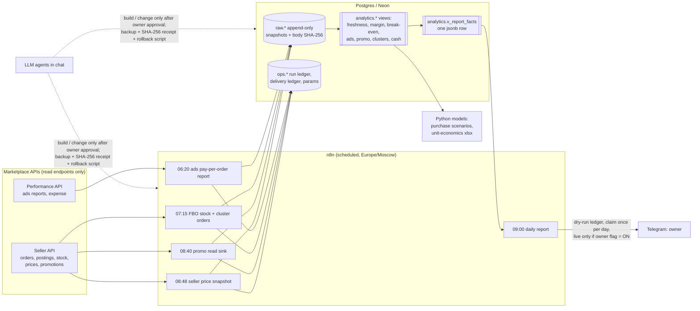

# Business OS — управленческая аналитика для бренда на Ozon, собранная с AI-агентами

**Что это:** n8n каждое утро забирает данные Ozon Seller и Performance API в Postgres (Neon), SQL считает маржу, безубыточность, рекламу, акции, отгрузки и кассу, а в 09:00 владелец получает один отчёт в Telegram, где у каждой цифры есть дата, а «нет данных» никогда не превращается в 0.
**Эффект:** вместо ручной сверки кабинетов и таблиц — один проверяемый отчёт и рекомендации (акции, отгрузки, закупки), которые ничего не меняют без решения владельца. По оценке владельца, это экономит около 4 рабочих часов в день.
**Как сделано:** я ставил задачи, правила и критерии приёмки; код писали агенты Codex и Claude Code по правилам репозитория ([AGENTS.md](AGENTS.md), [CLAUDE.md](CLAUDE.md)) с тестами, eval-гейтом для LLM и CI. Все данные здесь синтетические (бренд DemoBrand).

## Быстрый старт

```bash
make report        # отчёт из готовых синтетических фактов: без базы, без Docker (Node 18+)
npm test           # 73 Node-теста + eval-гейт: 15 ответов Grok Bot сверяются с фактами SQL, без API-ключа
make demo          # весь конвейер в Docker: Postgres → SQL → факты → отчёты → сценарии → xlsx
```

Дальше: [кейс](docs/case-study.md) · [вопросы владельца и eval](docs/llm-eval.md) · [PRD 002 → задачи](docs/prd/002-promo-approve.md) · [журнал проверки v0.5.1](docs/verification-v051.md) · демо-страница: `make site` → `site/dist/index.html` (публикуется GitHub Pages).

---

## In English

**Portfolio v0.5.1.** A synthetic, testable reconstruction developed with Codex and Claude Code. My role covers business requirements, architecture, acceptance criteria and control of live actions; agents implemented the code. See the [case study](docs/case-study.md) (Russian), [agent rules](AGENTS.md), [PRD example](docs/prd/002-promo-approve.md), [owner Q&A eval](docs/llm-eval.md) and [verification record](docs/verification-v051.md).

> Portfolio version. Built for a real small cosmetics brand that sells on a marketplace (Ozon, FBO model) and through
> a retail chain. **All data in this repository is synthetic**, the brand is called *DemoBrand*, and every secret,
> identifier and commercial number of the real business has been removed (see [docs/sanitization.md](docs/sanitization.md)).

## The problem

A small brand with several dozen SKUs had its numbers spread across a marketplace seller cabinet, an ads cabinet, retail-chain
documents and spreadsheets. Every morning the owner had to answer the same questions by hand:
*How much did we sell yesterday? Did we actually make money after fees, ads and VAT? Are we covering fixed costs this month?
Which promotions are worth joining? What to ship to which warehouse cluster? Do we have the cash for the next payment and the next purchase?*
Worse, the numbers he did see were often silently stale: a dashboard showing yesterday's zero orders because a loader had failed.

## What it does

* **n8n workflows** pull data from the Ozon Seller API and Ozon Performance (ads) API every morning: orders by SKU,
  per-posting FBO orders with buyer/shipping cluster, FBO stock by warehouse, seller prices, promotions (read-only), ads reports.
* Every response lands in **Postgres (Neon) as an append-only snapshot** — re-reading a day adds a new observation, never overwrites one.
* **SQL views** turn the snapshots into: daily margin (order model vs realised), daily break-even coverage, ads metrics
  (CTR / CPC / ACoS-DRR, reconciled with the expense ledger), promo profitability per SKU per action, demand share per
  cluster and a shipment recommendation, a cash calendar, data freshness and load coverage checks.
* A **09:00 Telegram report** summarises all of it in one message, with **explicit freshness labels**: stale data is never
  shown as today's, and missing data is written as "no data", never as 0.
* **Decision models** for the owner: purchase scenarios on top of the cash calendar, and unit-economics workbooks
  (xlsx with live formulas) comparing sales channels — domestic marketplace, a foreign entity, cross-border delivery, own web store.
* The system was designed, built and operated **together with AI agents (Codex, Claude Code and chat assistants)** (they wrote the SQL, workflows and
  scripts, made backups, ran dry runs) — under a strict rule that **nothing changes in production without the owner's explicit approval**.
  There are no LLM calls inside the daily data pipeline: the report is deterministic.
* **Owner Q&A with an eval gate** (`llm/`): the AI layer is Grok Bot, the owner's desktop AI assistant connected to Neon and n8n
  (there is no model API client). It answers from masked `v_report_facts` only; a deterministic grader blocks answers whose numbers are not bound to their own cited SQL fact
  (sign included), whose dates or times do not match, that turn «no data» into 0, claim a performed action, or leak masked values. 15 golden questions run in CI on the recorded Grok Bot answers ([docs/llm-eval.md](docs/llm-eval.md)).

## Architecture



### Data flow (one morning)

| Time (MSK) | Step | Output |
|---|---|---|
| 05:30 | orders by SKU for yesterday (analytics API; loader not included here) | `raw.order_day_sku_obs` |
| 06:20 | ads pay-per-order report: order report → poll → download, retry on 429/5xx, one retry on empty | receipt row with body + SHA-256 |
| 07:15 | FBO stock by warehouse; FBO postings D-4..D-1 (re-read to catch status changes) with buyer cluster | stock + posting-line observations, run receipt, **readback of landed rows** |
| 08:40 | promotions: actions, participating products, candidates, auto-add lists (read-only) | `run_event` STARTED/FINISHED, PARTIAL if any page is missing |
| 08:48 | seller prices for every SKU | price snapshot, response SHA-256 |
| 09:00 | one SELECT on `analytics.v_report_facts` → pure renderer → ledger → (optional) Telegram | one message ≤ 4096 chars |

## Key design principles

1. **Append-only snapshots.** Raw tables reject `UPDATE`/`DELETE`/`TRUNCATE` with a trigger; views pick the latest
   observation with `DISTINCT ON … ORDER BY captured_at DESC`. History is never lost and every number can be traced to the
   response it came from (stored body hash).
2. **Freshness labels, not silent gaps.** `analytics.v_source_freshness` knows the expected day of each source
   (today for snapshots, yesterday for daily reports). The report prints the date of every number and the reason if it is not the
   expected one ("no data for 14.04; last loaded day 13.04; today's load failed: HTTP 429"). `NULL` means *no data* and is never rendered as 0.
3. **Two margins, never summed.** The order-model margin (yesterday's orders × model fee rates) and the realised margin
   (actual marketplace accruals) are shown side by side; estimates are labelled as estimates; parameters carry a status
   (`OWNER_ACCEPTED`, `OWNER_STATED`, `ESTIMATE`, `DRAFT`).
4. **No automatic actions; the owner approves.** Promo, shipment and purchase outputs are recommendations
   (`ENTER` / `DONT` / `OWNER_DECIDES` with a reason). The collectors call read endpoints only (stock, postings and prices use a read-only API key); nothing in the pipeline writes to the marketplace.
   Live Telegram sending is behind a parameter that must be `1` *and* `OWNER_ACCEPTED`; every run is first written to a
   delivery ledger as a dry run, and a per-day idempotency key guarantees at most one live message per day.
5. **Coverage-based load verification.** A loader run is successful only if the rows it parsed equal the rows that
   actually landed in the table (read back by run id) — otherwise the execution fails closed instead of going green.
   Two independent APIs (analytics orders vs FBO postings) are reconciled per day: `MATCH` / `DIFF` / `NO_SECOND_SOURCE`.
6. **Rollback before change.** Every production change was preceded by a read-only backup of the workflow, a `SHA256SUMS`
   file and a receipt; rollback scripts refuse to restore a file whose hash does not match, run as a dry run by default and read the result back.

## Tech stack

n8n (Cloud) · Ozon Seller API · Ozon Performance API · PostgreSQL (Neon) · SQL views · Python (psycopg2, openpyxl) ·
JavaScript / Node.js (n8n Code nodes, renderer, owner Q&A, node:test) · Telegram Bot API · Grok Bot (owner's AI assistant over Neon and n8n) ·
AI coding agents: Codex, Claude Code.

## Repository layout

```
workflows/   sanitized n8n exports (credentials, ids, pinData, instance URLs removed) - see workflows/README.md
sql/         runnable demo schema: tables (00-02, incl. collector landing tables), views (10-20), rollback (99),
             optional/ = least-privilege role grants for the n8n credential
scripts/     synthetic data generator, loader, report renderer (shared with the n8n node), purchase scenarios,
             unit-economics xlsx builder, n8n backup/rollback with SHA-256 receipts, workflow sanitizer, secret scan
sample_data/ synthetic CSVs (regenerate with scripts/generate_synthetic_data.py)
docs/        architecture, principles, modules, case study, PRD, tasks, LLM eval and verification records
examples/    rendered report (RU + EN), facts JSON, purchase scenarios CSV, unit-economics workbook
llm/        owner Q&A: masking config, prompt builder + answer gate, deterministic grader, golden eval + recorded Grok Bot answers
site/        static demo page generated from demo outputs (site/build.js), deployed by GitHub Pages
tests/       renderer, Q&A, promo buttons, tooling and real PostgreSQL regressions
.github/     CI: syntax, tests, eval gate, PostgreSQL, reproducible examples, renderer sync, Gitleaks, container demo; Pages
AGENTS.md    development and acceptance rules for agents; CLAUDE.md imports it for Claude Code
package.json npm test / npm run eval / npm run site
```

## Run the isolated demo

With Docker Desktop/Engine running:

```bash
docker compose up --build --abort-on-container-exit --exit-code-from demo
```

The first build downloads images/dependencies. The runtime network is internal, the database has no published port, production keys are not inherited, and n8n/Ozon/Telegram are not called. PostgreSQL data is disposable. Reports, facts JSON, scenarios and workbook are copied into `demo-output/`. This is a pipeline demo, not n8n deployment.

`docker compose down` removes the demo containers, not `demo-output/`.

Without Docker, use a **new local disposable database** named exactly `bos_portfolio_demo`:

```bash
pip install -r requirements.txt            # Python 3.10+, Node 18+ for the renderer
createdb bos_portfolio_demo                # never use an existing business database
export DATABASE_URL=postgresql://localhost/bos_portfolio_demo
python3 scripts/run_demo.py                # generate -> load -> facts -> report -> scenarios -> xlsx
cat examples/report_example_en.txt
```

The loader drops/recreates its demo schemas and refuses external hosts, other names, URI query options and libpq environment overrides. For a host run, remove inherited `PG*` settings except `PGPASSWORD` first. Naming checks prevent accidental targets; they are not a sandbox for arbitrary code.

No database? `node scripts/render_report.js examples/facts_example.json en DRY_RUN` renders committed synthetic facts without sending anything.

## Verify an agent change

```bash
npm test                                   # Node tests + owner Q&A eval gate (recorded answers)
python scripts/check.py                    # syntax, inactive/read-only exports, Node/Python tests, eval, sync
python scripts/check.py --sql              # also SQL tests; requires a loaded local demo DB
python scripts/scan_secrets.py             # mandatory Gitleaks tree + all Git history
```

After editing the renderer/adapter, regenerate with `python scripts/inline_renderer_into_workflow.py`. `--check` is read-only and fails on drift. Install Gitleaks before scanning: absent tooling is not clean. CI uses checksum-verified [Gitleaks 8.30.1](https://github.com/gitleaks/gitleaks/releases/tag/v8.30.1) and pinned action commits. Docker waits for a [healthy PostgreSQL service](https://docs.docker.com/compose/how-tos/startup-order/) before starting the pipeline.

## Sample daily report (synthetic data, English rendering)

The production report is in Russian ([examples/report_example.txt](examples/report_example.txt)); the renderer also has an English mode.
The demo data deliberately contains failures — yesterday's orders load failed, the pay-per-order report is missing, accruals lag —
to show how the report labels them.

```
DemoBrand morning report · 15.04, Wednesday · draft, not sent to Telegram

1) Orders — no data for 14.04; last loaded day 13.04 (loaded 14.04 05:30). Today's load failed: HTTP 429 after 4 retries.
77 units, 112.6 k RUB (cancelled 4). vs 12.04: +7 units, +7.5 k RUB. vs the 7-day average before it (78.6 units; 120.8 k RUB/day): −2% units, −7% revenue.

2) Margin (two different numbers — never added up)
Orders of 13.04, if everything is bought out: +30.7 k RUB — after COGS, marketplace fees and logistics (model rates), VAT (model) and ads 6.9k. Adjusted for buyout rate: +23.2 k RUB.
Realised accruals for 12.04 (sold 47 units for 75.8 k RUB): +13.5 k RUB — actual marketplace charges, COGS and VAT by model. No accruals yet for 13.04.

3) Break-even: 15 k RUB of contribution needed per day (fixed costs + financing, divided by days in month)
13.04 by orders: 205% (30.7 of 15). Month to date (13 days): by orders 230%, ahead by 252.9 k RUB; by realised accruals (12 days) 120%, ahead by 35.8 k RUB.
Estimates: fee and logistics rates, VAT and COGS are model parameters, not actuals.

4) Ads for 14.04
Cost-per-click: 4.3k RUB; 11.8k impressions, CTR 2.8%, CPC 12.9 RUB, 17 ad orders. Matches the ad-account expense ledger.
Pay-per-order: expense ledger 0.9k RUB; no report for 14.04 — orders from this model are unknown (not zero).
ACoS for 14.04 — no data: orders of that day are not loaded. Month to date: 75.3k RUB, ACoS 4.7% (days with loaded orders).

5) Prices and promotions
Seller price: snapshot 15.04 08:48 (24 SKUs) vs 14.04: no changes. Last changes 08.04: 2 SKUs (all up), e.g. Clay mask 100 ml 1,380→1,560, Sun stick SPF50 18 g 1,910→2,050.
14 of 24 SKUs have a promo price below the regular price.
Promotions (measured 15.04 08:41): 3 actions, 13 SKU entries participating. Next start 17.04 "Weekend flash sale": 9 SKUs — enter 2, don't 3, owner decides 4. Auto-add on 16.04: 6 SKUs, 2 of them "don't"; margin −1.5 k RUB/day at current sales. Estimate only; the sales uplift is unknown; nothing is joined automatically.

6) Stock and shipments
FBO stock 15.04 07:15: 2 of 24 SKUs have no free stock. Key (A/B) SKUs at 0–5 units: Eye cream 20 ml — 0.
Shipments for 45 days of demand (cluster orders to 14.04, stock 15.04): 926 units in 137 SKU×cluster lines; largest — Moscow 311, Kazakhstan 97, Siberia 96, South 83. A recommendation, not a shipment request.

7) Cash
Cash is not confirmed by a bank statement: the owner stated 40,000 RUB on 12.04. Next large payment 20.04 (70 k RUB): planned balance before it ~140.1 k RUB — covered. 30-day minimum: +70.1 k RUB (20.04). Marketplace payouts are estimates.

Order reconciliation of two APIs, 30 days: match 27, diff 2, no second source 1.
All recommendations are calculations: nothing is switched on or changed automatically.
```

## Honest scope

* This repository is a **demo reconstruction**: the n8n collectors are sanitized exports of the real workflows, re-pointed
  at the demo schema (table names were neutralised, node logic is unchanged); the SQL in `sql/` is a simplified, runnable
  adaptation of the real views (same patterns, fewer columns, one set of schemas instead of several).
  Rates and costs are synthetic parameters.
* Not included: the retail-chain contour (price scraping of the chain's site, retail payments, shipments), P&L history,
  SKU strategy cards, the Telegram bot's other commands and the agent-orchestration notes — they are either tied to real
  commercial data or not reproducible without it.
* Known limitations in production at the time of writing: commission/logistics per order are model rates until accruals arrive;
  some ads metrics were only available as a rolling window, so they were *not* shown rather than shown wrong.

## What I would do next

* Move the remaining hard-coded model rates to accruals-based per-SKU rates as soon as accrual history is long enough.
* Add alerting on `STALE` sources before 09:00 (re-run the loader) instead of only labelling them in the report.
* Turn the promo calculator into a weekly owner checklist with "approve / reject" buttons in Telegram that write to the decision log.
* Extend the existing regressions to additional source-coverage and financial-policy cases after agreeing their semantics.
* Generalise the collectors into a template for other marketplaces (Wildberries, Yandex Market) — the snapshot/freshness/ledger layers do not change.

## Подробнее по-русски

**Business OS** — система управленческой аналитики для небольшого косметического бренда (Ozon FBO + розничная сеть), собранная
вместе с LLM-агентами. n8n каждое утро забирает данные из Ozon Seller API и Performance API (заказы, отправления FBO по кластерам,
остатки, цены, акции, реклама) и складывает их в Postgres (Neon) как неизменяемые снимки. SQL-представления считают маржу
(по заказам и по факту начислений — отдельно, не складывая), точку безубыточности (ТБУ) по дням, рекламу (CTR, CPC, ДРР со сверкой
с выпиской расходов), выгодность акций по каждому SKU, спрос по кластерам и рекомендации отгрузок, денежный календарь.
В 09:00 владельцу приходит один отчёт в Telegram, где у каждой цифры есть дата данных: устаревшее не выдаётся за сегодняшнее,
отсутствие данных пишется как «нет данных», а не 0. Ничего не применяется автоматически: акции, отгрузки, закупки — только
рекомендации, решение за владельцем; перед каждым изменением — бэкап, SHA-256-квитанция и скрипт отката.

В этом репозитории все данные синтетические (бренд *DemoBrand*), секреты и коммерческие данные удалены. Запуск демо — см. [«Быстрый старт»](#быстрый-старт) и [«Run the isolated demo»](#run-the-isolated-demo).

## License

MIT — see [LICENSE](LICENSE).

